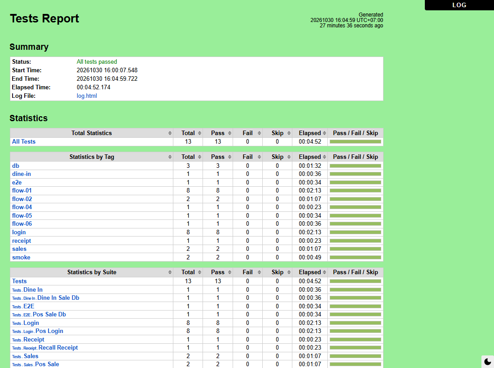
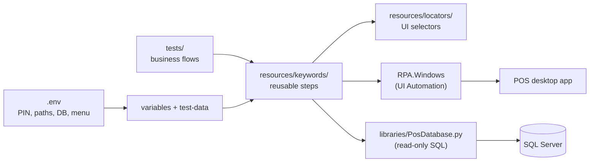

# POS Test Automation — Robot Framework


End-to-end test automation for a **Windows desktop POS** (point of sale) used
in restaurants. The tests drive the real application through Windows UI
Automation and then check what it saved in **SQL Server**, so a test passes
only when both the screen and the database are right.

**13 tests, 5 business flows, all passing on the live POS.**



## What this project shows

- **Business-level tests.** Test cases read like the flow a cashier follows;
  clicks and waits live in reusable keywords.
- **UI + database assertions.** After a sale, the saved bill must match the
  total on screen, Tendered = Total, Change = 0, and contain the ordered item.
- **Debugging a real application, not a demo app.** Every failure on the live
  POS and how it was traced and fixed is recorded in
  [`docs/inspection-log.md`](docs/inspection-log.md). A few are summarized under
  [Problems solved](#problems-solved).
- **Engineering around the tests:** one-command runner, tags, screenshot on
  failure, secrets and test data in `.env`, Robocop lint and a CI dry run on
  every push.

## How it fits together



## Test coverage

| Flow | Tests | What is checked |
|---|---|---|
| 01 Login | POS-LOGIN-001 … 008 | Valid / wrong / empty / too-short PIN, Clear button, retry after failure, logout and login again, login state on screen |
| 02 Cash sale | POS-SALE-001, 003 | One and two items: total updates after each item, payment dialog asks for the order total, balance 0.00, screen resets after the sale |
| 04 Receipt recall | POS-RECEIPT-001 | Opens a random saved bill; subtotal, discount, tax and total on screen equal the database |
| 05 Sale + database | POS-E2E-001 | Walk-in sale, then the saved bill is checked in SQL Server |
| 06 Dine-in + database | POS-DINEIN-001 | Open a table, enter guests, order, pay, then check the saved bill |

Full flow descriptions: [`docs/flows.md`](docs/flows.md).

## Problems solved

Real issues found while running against the live POS:

| Problem | What was going on | Fix |
|---|---|---|
| Buttons not found ("OK") | Locators matched English captions; the POS runs in Thai | Locate by control AutomationId, which does not depend on language |
| Receipt total read as "4" instead of 2,683.56 | Amounts used a positional locator; on long bills a scrollbar appears and shifts the footer by one, so it pointed at a data row. Found only because the test picks a **random** bill | Locate the grid's footer cells by caption; verified on long, short and discounted bills |
| Discount on screen 149.00, database 0.00 | Query read only the bill-level discount; this bill had an item-level one | Sum both; the formula holds for 34,284 of 34,301 historical bills |
| 16 s lost checking for an optional popup | Searching the whole desktop for a window that is not there is slow, far beyond the set timeout | Poll inside the POS window every 0.2 s for whichever appears first: 16.4 s → 0.07 s |
| Leftover POS processes between tests | The POS relaunches itself, leaving the real process orphaned | `scripts/close_pos.ps1` closes only orphaned POS processes by PID, never one a person has open |

## Project structure

```
├── tests/                  test cases only, one folder per flow
├── resources/
│   ├── keywords/           reusable steps (login, sales, receipt, dine-in, common)
│   ├── locators/           UI selectors, one file per screen
│   └── variables/          config read from .env
├── libraries/              PosDatabase.py - read-only SQL checks
├── test-data/              menu data (real names come from .env)
├── scripts/                close_pos.ps1 - safe process cleanup
├── docs/                   flows, architecture decisions, inspection log
├── run.ps1                 test runner
└── .github/workflows/      CI: Robocop + dry run
```

Code comments and keyword documentation are written in Thai.

## Setup

Windows only — RPA.Windows drives the Windows UI Automation tree. Database
checks need *ODBC Driver 17 for SQL Server*.

```
python -m venv .venv
.venv\Scripts\activate
pip install -r requirements-dev.txt
copy .env.example .env      # PIN, POS path, database, menu names
```

## Running

The tests use the real mouse and keyboard, so leave the machine alone while
they run. Each run is saved to `evidence/<timestamp>/`; a failing test also
saves a screenshot there.

```
.\run.ps1                                     # all tests
.\run.ps1 -Include smoke                      # quick check: login + one sale
.\run.ps1 -Tests tests/sales                  # one flow
.\run.ps1 -DryRun                             # check keywords and arguments, no POS
.\run.ps1 -Tests tests/receipt -Variable RECALL_SALE_NUM:<bill number>   # re-run one bill
```

Every test starts its own POS and closes it afterwards, so tests do not depend
on each other or on run order.

| Tag | Meaning |
|---|---|
| `smoke` | Minimal health check (POS-LOGIN-001, POS-SALE-001) |
| `flow-01` … `flow-06` | Business flow |
| `login`, `sales`, `receipt`, `e2e`, `dine-in` | Functional area |
| `db` | Also checks SQL Server |
| `pending-first-run` | New test not yet run on the real POS |

Lint: `robocop --argumentfile .robocop tests resources`. CI runs Robocop and a
dry run on every push; the UI tests need the real POS and database, so they
run on the test machine.

## Next

- Flow 03 payment checks and POS-SALE-002 (payment with change)
- Data-driven sales test (`Test Template`) over several menu items
- Bill-level discount (no such bill in the test database yet)
- Receipt printing as its own test
